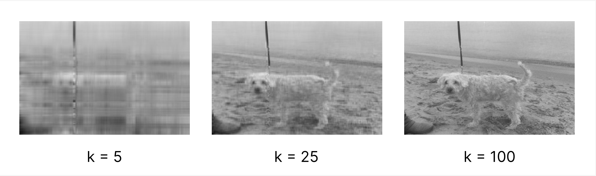

# SVD Image Compression

Compress images using low-rank approximations. A higher *k* will result in better approximations but requires more data to encode the image.



## Usage

```
$ cargo run <path_to_image>
```

Alternately, you can compile the package first and then run the executable:

```
$ cargo build --release
$ ./target/svd-image-compression <path_to_image>
```

Optionally you may also pass in `max_iterations` as a second argument. By default, this is set to 500.

Note that large images will take longer to compress.

## Notes

I got the idea for this project when my Linear Algebra II professor had given us a demo about how SVD could be used to visually compress images. I think the results are quite beautiful and illustrative of how low-rank approximations work. The provided code implements a small matrix math library and the Golub-Kahan-Reinsh algorithm. These steps are:

1. [Bidiagonalize](https://en.wikipedia.org/wiki/Bidiagonal_matrix) the matrix via Householder reductions to obtain a bidiagonal matrix `B`
2. Diagonalize `B` using iterative implicit QR via 2x2 Givens rotations (and Wilkinson shifts to speed up convergence)
3. Flip any signs and sort diagonal entries (which will be singular values) from largest to smallest

This project was made before I took numerical computing and back when I was still majoring in Math, so some of the benefits of numerical stability in the algorithm might be lost as I was largely unfamiliar with floating point error propagation. I think there is a good deal of optimizations and in-place operations that could be done to make it more performant. Though I mainly use C++, I liked the flexibility of Rust in writing a matrix library. Very MATLAB like, except I chose to use a row-major representation. In hindsight, I would've chosen a column-major memory layout and kept the row-major indexing. The joys of learning about cache locality :) 

## References

- [The First Algorithm to Compute the SVD](https://people.inf.ethz.ch/gander/talks/Vortrag2022.pdf)
- [Singular Value Decomposition](https://en.wikipedia.org/wiki/Singular_value_decomposition)
- [Stable Calculation of Givens Rotation](https://en.wikipedia.org/wiki/Givens_rotation#Stable_calculation)
- [Lecture Note 15: The Singular Value Decomposition](https://utminers.utep.edu/xzeng/2017spring_math5330/MATH_5330_Computational_Methods_of_Linear_Algebra_files/ln15.pdf)
